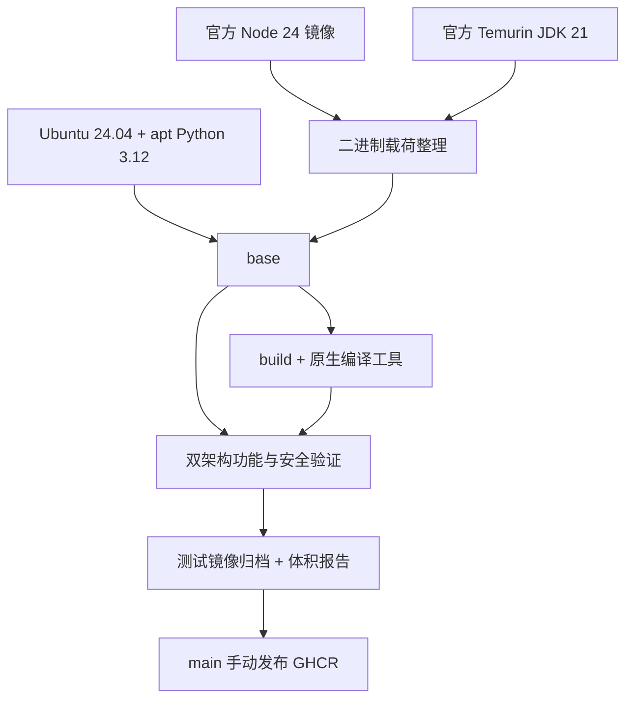

# 架构与取舍

采用 Ubuntu 原生 Python，避免自行维护 CPython 编译和安全补丁。Node 取官方 Debian glibc 二进制，最终运行环境仍为 Ubuntu 24.04；JDK 取 Temurin noble。不同架构由 BuildKit 自动选择上游平台镜像，不把 amd64 载荷复制给 arm64。

完整 JDK 保留 bin、jmods、include、lib、legal；不使用 jlink 生成受限 JRE。仅移除可选 lib/src.zip。保留 npm、Node headers（原生扩展需要）以及所有包管理数据库。

构建控制：固定 Action commit；镜像输入允许通过 build args 替换为企业审核过的 digest。本地默认 tag 随上游安全更新浮动，因此不能宣称可逐字节复现。CI 先把三个上游 tag 解析成不可变多架构 index digest，优化/对照构建使用同一组摘要，报告保留 upstream-*.txt 和 BuildKit metadata。不同执行间 Ubuntu apt 仓库仍可能更新；严格历史复现应使用企业快照源。

build 继承同一 base 阶段，保持共享层；cache scope 按架构和变体隔离。无 SSH、守护进程、密码、内置访问令牌。企业 CA 应在派生镜像中安装，不关闭 TLS 验证。

发布仅在 main 的 workflow_dispatch 且版本格式有效时运行。建议管理员给 main 配置必需检查和 PR 审核、给 release environment 配置人工审批；这些仓库管理策略不由源码自动启用。
